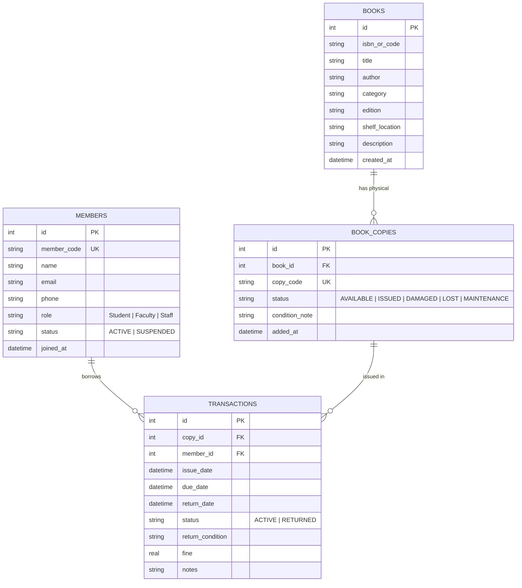

# 📚 Library Management System (LIBMNGSYM)

> **A Full-Stack Enterprise Library Management & Circulation Tracking System**  
> Complete with Book Cataloging, Barcode/Copy Tracking, Member Directory, Circulation (Issue/Return), Fine Calculation, Damage Audit Timeline, and Analytics Dashboard.

---

## 📌 1. Project Overview: What is this Project?

**LIBMNGSYM** is a modern, responsive web application designed for academic libraries, schools, colleges, and reading clubs. It automates the everyday tasks of a librarian:

1. **Catalog Management**: Adding books with ISBN/codes, categories, shelf locations, and batch-generating physical copies (e.g. `BK-001`, `BK-002`).
2. **Individual Copy Tracking**: Unlike basic systems that only store a "total count", this system tracks **each physical copy individually** with its own status (`AVAILABLE`, `ISSUED`, `DAMAGED`, `LOST`, `MAINTENANCE`).
3. **Member Directory**: Managing student and faculty memberships with role tags, loan limits, contact info, and activity history.
4. **Circulation Desk (Issue & Return)**:
   - **Issue (Checkout)**: Assigning a copy to a registered member with a defined due date (default: 14 days) in a database transaction.
   - **Return (Checkin)**: Returning a book copy, logging its physical return condition, automatically computing overdue fines, and updating copy availability.
5. **Damage Audit & History Inspector**: Complete historical timeline of who borrowed any specific physical copy last, who damaged it, when it was returned, and its condition notes.
6. **Live Analytics & Reports**: Overview metrics (total titles, copies in stock, issued books, damaged count, overdue alerts) and one-click CSV export/database backup.

---

## 🏗️ 2. Architecture & Technology Stack: How Does It Work?

The project follows a standard **Client-Server Architecture**:

```
+--------------------------------------------------------------+
|                    FRONTEND (Client Browser)                 |
|  - HTML5 (Semantic Structure)                                |
|  - Vanilla CSS3 (Custom Design System, Glassmorphic UI)      |
|  - Vanilla JavaScript (SPA Navigation, REST API Fetch calls) |
+------------------------------+-------------------------------+
                               | HTTP REST APIs (JSON)
                               v
+--------------------------------------------------------------+
|                     BACKEND OPTIONS                          |
|  Option A: Node.js + Express (server.js & db.js)             |
|  Option B: Java + Spring Boot (backend-java/)                |
|  - REST Controller endpoints                                 |
|  - ACID Transaction management                               |
|  - Static asset serving for public/                          |
+------------------------------+-------------------------------+
                               | SQL Queries (DDL / DML)
                               v
+--------------------------------------------------------------+
|                     DATABASE LAYER                           |
|  Current: SQLite 3 (library.db) with WAL mode & Foreign Keys |
|  Alternative: MySQL 8.x (Fully supported in Java backend)    |
+--------------------------------------------------------------+
```

### Which Database is it currently using?
- **Current Database: SQLite 3** (stored in `library.db`).
- **Is it MySQL?** No, the current running backend uses SQLite via the `better-sqlite3` driver.
- **Why SQLite was chosen initially:** It requires zero server setup, is self-contained in a single file, supports full ACID transactions, and works out-of-the-box on any machine.
- **Can it run on MySQL?** Yes! The database schema uses standard SQL tables. In the Java backend (`backend-java/`), you can switch from SQLite to MySQL simply by updating 4 lines in `application.properties`.

---

## 🗄️ 3. Database Schema Overview

The database consists of 4 relational tables:



---

## 🚀 4. How to Run the Project

### Running Option 1: Node.js Backend (Default)
1. Ensure **Node.js** (v18+) is installed.
2. In the project root directory, install dependencies:
   ```bash
   npm install
   ```
3. Start the server:
   ```bash
   npm start
   ```
4. Open your browser and navigate to:
   ```
   http://localhost:3000
   ```

---

### Running Option 2: Java Backend (Spring Boot)
1. Ensure **Java 21** and **Maven** are installed.
2. Navigate to the `backend-java` folder:
   ```bash
   cd backend-java
   ```
3. Build and run using Maven:
   ```bash
   mvn clean spring-boot:run
   ```
4. Open your browser and navigate to:
   ```
   http://localhost:8080
   ```

---

## 📂 5. Project Directory Structure

```
LIBMNGSYM/
├── public/                       # Frontend SPA (Vanilla Web Standards)
│   ├── index.html                # Main UI Structure & Modals
│   ├── app.css                   # Custom CSS Design System
│   └── app.js                    # UI Controller & REST Client
├── server.js                     # Node.js Express REST API server
├── db.js                         # SQLite Database initialization & seed data
├── library.db                    # Active SQLite database file
├── package.json                  # Node.js dependencies & scripts
├── backend-java/                 # Java Spring Boot backend alternative
│   ├── pom.xml                   # Maven dependencies & build setup
│   └── src/main/java/com/libmng/ # Spring Boot Controllers, Services, DAOs
├── questions/                    # Viva, Interview & Project Defense Documentation
│   ├── COMMANDS_AND_OPERATIONS.md# Minute details of every command (Add/Issue/Return)
│   ├── JAVA_QUESTIONS.md         # Full Q&A for Java, Spring Boot, OOP & Concurrency
│   ├── DATABASE_QUESTIONS.md     # Full Q&A for SQL, Schema, SQLite vs MySQL, ACID
│   └── QUESTIONS_THAT_CAN_BE_ASKED.md # Comprehensive Project Defense Questions
└── README.md                     # Project overview and instructions (This file)
```

---

## 📖 6. Essential Documentation Links

For comprehensive preparation and technical defense:
- [Every Operation & Command in Minute Detail](file:///c:/Users/aksin/OneDrive/Desktop/LIBMNGSYM/questions/COMMANDS_AND_OPERATIONS.md)
- [Database Q&A (SQLite, MySQL, Queries, Normalization)](file:///c:/Users/aksin/OneDrive/Desktop/LIBMNGSYM/questions/DATABASE_QUESTIONS.md)
- [Java Q&A (Spring Boot, Core Java, OOP, REST API)](file:///c:/Users/aksin/OneDrive/Desktop/LIBMNGSYM/questions/JAVA_QUESTIONS.md)
- [Comprehensive Viva & Project Defense Guide](file:///c:/Users/aksin/OneDrive/Desktop/LIBMNGSYM/questions/QUESTIONS_THAT_CAN_BE_ASKED.md)
